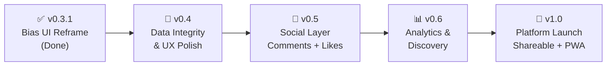

# 🎬 KinoVibe — Improvement Roadmap

> Based on the honest codebase review. Ordered by impact vs. effort. Each version has a clear theme so work feels purposeful, not scattered.

---

## ✅ Done — v0.3.1 (Just Shipped)

- [x] **Bias UI reframed** — section renamed to *Personal Bias (subjective nudges)*, explanatory copy added, preset buttons now show emoji + reason instead of bare `+1 Soundtrack` labels
- [x] **Score breakdown upgraded** — now shows `Base 8.0 · Bias weight +4 (effect: +1.0) = Final` so users can see the actual dampened impact
- [x] **Two new presets added** — 💛 Nostalgia (+2) and 📢 Overhyped (-2)
- [x] **Tooltip hints on every preset** — `title=""` explains each button's behaviour on hover

---

## 🔧 v0.4 — Data Integrity & UX Polish
> **Theme: Fix the quiet bugs. Make what exists trustworthy.**

### High Priority
- [ ] **Duplicate review guard on add form** — on TMDB movie select OR on form submit, query Supabase for existing `tmdb_id` or `title+year`. Show a warning banner with a link to the existing review. Prevent silent duplicates.
- [ ] **Genre filter moved to Supabase query** — `getPublicFeed()` currently fetches 24 records then filters genre client-side. Move `genres @> '["Action"]'` into the DB query so pagination works correctly.
- [ ] **Community feed "Load More"** — the UI stops at 24 records with no way to paginate. Add a *Load More* button that increments the `page` param (service already supports it).

### Medium Priority
- [ ] **Review text preview on community cards** — the feed shows poster + score but no opinion text. Add a 2-line truncated review snippet so users have a reason to click through.
- [ ] **"Want to Watch" / "Abandoned" status** — the DB already has a `status` column. Surface it in the form as a radio: `Completed · Want to Watch · Abandoned`. Library can show separate shelves per status.
- [ ] **Merge matrix variants** — `matrix.html`, `matrix-rare.html`, `matrix-story.html` are three separate pages doing roughly the same thing. Merge into one page with a view switcher dropdown.

---

## 💬 v0.5 — Social Layer
> **Theme: Turn the community feed from a gallery into a conversation.**

### Must Have
- [ ] **Review comments** — 1-level flat comments on public reviews. Schema: `comments(id, movie_id, user_id, body, created_at)` with RLS. UI: a collapsible comment thread below the review detail.
- [ ] **Reactions / Likes** — a single ❤️ / 🎬 reaction count per public review. Schema: `reactions(movie_id, user_id)` with unique constraint. No complex multi-emoji needed at this stage.
- [ ] **Follow / Friends** — follow other cinephiles. Your library feed shows followed users' recent reviews first. Schema: `follows(follower_id, following_id)`.

### Nice to Have
- [ ] **Notifications** — basic in-app toast/bell when someone comments on your review or follows you. Supabase Realtime subscription.
- [ ] **Activity feed** — a personal timeline of events: *"@username reviewed Dune: Part Two — 8.5"*

---

## 📊 v0.6 — Analytics & Discovery
> **Theme: Give people insight into their own watching habits.**

- [ ] **KinoVibe avg vs. TMDB avg** — on every review detail page, show `KinoVibe: 8.2 · TMDB: 7.4` side by side. This is the core platform pitch made visible. Pull TMDB avg from the already-stored `tmdb_id`.
- [ ] **Yearly Wrap-Up page** — `/wrap/2026` — your stats for the year: films logged, top genre, highest/lowest scored, most biased movie, Craft vs. Fun breakdown chart.
- [ ] **Director / Actor Filmography Matrix** — search for a director or actor via TMDB, fetch their filmography, let the user plot every film they've reviewed from that filmography on the 2D Vibe Matrix. E.g. "Show me all Nolan films I've rated." This is a genuinely differentiated feature Letterboxd can't do.
- [ ] **Genre taste profile** — radar/spider chart showing your average scores per genre (Action films you rate on Craft vs. Horror films you rate on Fun, etc.)

---

## 🚀 v1.0 — Platform Launch
> **Theme: Make it shareable. Make people want to send it to friends.**

- [ ] **Individual shareable review cards (PNG export)** — extend the existing canvas export (tiers + matrix) to single review detail pages. Output: a branded card with poster, criteria bars, bias list, final score, and @username watermark. One-click share to Twitter/Instagram.
- [ ] **PWA / installable** — add `manifest.json` + service worker. Mobile users can install KinoVibe to their home screen. Enable offline review viewing from cache.
- [ ] **Custom scoring profiles** — *Horror Mode* (Gore, Tension, Lore, Fun), *Documentary Mode* (Truth, Craft, Impact, Rewatchability). Users pick a profile per review. The 4 criteria labels swap but the math stays the same.
- [ ] **Public filmmaker pages** — TMDB-powered pages for directors/actors showing aggregate KinoVibe community scores across their filmography. Linkable, SEO-friendly.
- [ ] **Username-based public URLs** — `kinovibe.app/u/wengdev` instead of `?u=uuid`. Requires username uniqueness enforcement at DB level (unique constraint + slug validation on profile save).

---

## 🗺️ Timeline Overview

---

## 🎯 If You Only Do One Thing Per Version

| Version | Single highest-ROI task |
|---|---|
| **v0.4** | Duplicate review guard — small fix, big data quality win |
| **v0.5** | Flat comments on reviews — transforms community feed from read-only to social |
| **v0.6** | KinoVibe avg vs. TMDB avg on detail page — makes the core platform pitch *visible* |
| **v1.0** | Individual shareable review PNG cards — organic growth engine |
